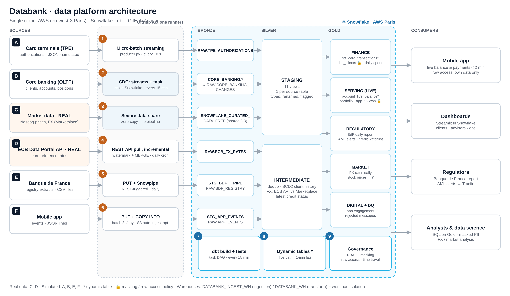
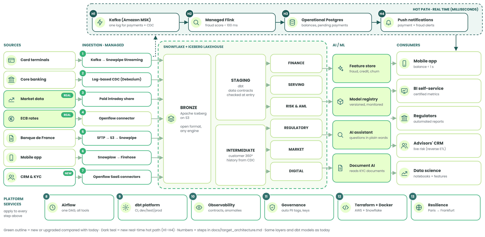

# Databank · a complete data platform for a fictive bank

Final project for the *Data Engineering* course at Albert School (oral defense, November 2026).

**Databank** is an imaginary French bank with a mobile app, cards and investment accounts.
This repository contains its whole data platform: data comes from **6 different sources**, enters
through **6 different ingestion methods**, is stored and transformed in **Snowflake on AWS (Paris region)**
with **dbt**, and is served to a client app, analysts and the regulator.
The whole project runs on **free tiers and free trial credits: it costs €0**.



> **New here? Read in this order (about 15 minutes):**
> 1. This page: the business problem, the picture above and the grading checklist below.
> 2. [docs/company.md](docs/company.md) and [docs/use_cases.md](docs/use_cases.md): who Databank is, and the 3 decisions the data supports.
> 3. [docs/architecture.md](docs/architecture.md): what each letter (sources) and number (steps) in the picture means.
> 4. [docs/evidence.md](docs/evidence.md): the proof that it works (verified figures, failed test, replay, access denied).
> 5. [docs/design_questions.md](docs/design_questions.md): latency, scaling, ownership, single source of truth, cost, security.

---

## 1. The business problem and the three use cases

Databank (fictive mobile bank, 250,000 clients, of which 10,000 are simulated in Snowflake) has data in
separate systems and no single view of it. The platform serves **three use cases**
([company.md](docs/company.md), [use_cases.md](docs/use_cases.md)):

| | Use case | Decision it supports, and who decides | Freshness | Served by |
|---|---|---|---|---|
| UC1 | Live card payments and available balance | "Can I afford this?": the client, in the app | ≤ 1 minute | `MARTS.ACCOUNT_LIVE_BALANCE` |
| UC2 | Spending dashboard and portfolio (real market prices) | budget by category (client); propose a product (advisor) | 15 min / daily | `MARTS.CLIENT_DAILY_SPEND`, `MARTS.PORTFOLIO_VALUATION` |
| UC3 | Banque de France reporting and anti-money laundering | file a Tracfin declaration, submit daily figures (compliance) | daily | `MARTS.REG_BDF_DAILY_REPORT`, `MARTS.AML_ALERTS` |

The required freshness decides the technology: only UC1 justifies near-real-time processing; everything
else runs in cheaper batches (see [design_questions.md](docs/design_questions.md#1-latency-what-does-the-business-really-need)).

## 2. Grading checklist

| ID | Criterion | What we deliver | Where to check |
|---|---|---|---|
| C1 | Convincing fictional company | revenue model, customers, size, stakeholders, constraints in numbers, explicit assumptions A1–A6 | [company.md](docs/company.md) |
| C2 | Use cases and business value | 3 use cases: decision, user, metric (grain, formula, exclusions), frequency, acceptance tests | [use_cases.md](docs/use_cases.md) |
| C3 | Working end-to-end pipeline | 6 sources, 32 dbt models; output checked against known data and an independent recomputation; documented launch; containerised job | [evidence.md](docs/evidence.md), [live_demo.md](docs/live_demo.md), [runbook.md](docs/runbook.md), [ingestion/Dockerfile](ingestion/Dockerfile) |
| C4 | Tools appropriate to the requirements | each tool justified, alternatives and trade-offs, what we chose **not** to use | [warehouse_choice.md](docs/warehouse_choice.md), [orchestration_containers_iac.md](docs/orchestration_containers_iac.md) |
| C5 | Actual, controlled cloud use | Snowflake on AWS Paris; loaders and a containerised job run from GitHub Actions; Terraform **applied**, state protected in an encrypted stage | [terraform/](terraform/), [evidence.md](docs/evidence.md#6-scheduling-and-run-history) |
| C6 | Reliability, quality and operations | key, business-rule and freshness checks; a demonstrated failure; replay without double counting; task graph; 2 incident scenarios, both tested | [evidence.md](docs/evidence.md), [incidents.md](docs/incidents.md) |
| C7 | Security and costs | allowed/denied access verified; masked personal data; secrets out of the code; cost in free credits + projection; budget cap and shutdown procedure | [security.md](docs/security.md), [runbook.md](docs/runbook.md#costs) |
| C8 | Slides and presentation | storyline, architecture, evidence, limitations, speaking order | slide deck + [Section 13](#13-limitations) |

Also covered from the course brief: several kinds of sources (terminals, internal database, marketplace,
public API, regulator files, app logs), several ingestion methods and no drag and drop, one cloud, dbt,
documentation in 17 pages plus one README per folder, a clear folder system, and one owner per area
([Section 8](#8-team-and-ownership)).

## 3. The six sources and how each one is ingested

The letters match the diagram. Each source uses a **different** ingestion method, chosen for how that data
behaves in real life.

| | Source | Real or simulated | Ingestion method | Why this method |
|---|---|---|---|---|
| A | Card payment terminals | simulated | **Micro-batch streaming**: small batches every 10 seconds | payments must reach the app within a minute |
| B | Core banking system (clients, accounts, positions) | simulated | **CDC** (change data capture) with Snowflake streams | only changes are copied, never the whole table again |
| C | Stock prices and exchange rates (Snowflake Marketplace) | **real** | **Secure data sharing**: zero copy | the provider maintains the data; nothing to load |
| D | European Central Bank exchange-rate API | **real** | **REST API pull, incremental**: only new days, then MERGE | a public API that publishes once a day |
| E | Banque de France registry files (CSV) | simulated | **File + Snowpipe**: file is put in a stage, Snowpipe loads it | regulators send files; Snowpipe never loads a file twice |
| F | Mobile app events (JSON) | simulated | **Batch file load** (`COPY INTO`) | logs are large but not urgent: load them 3 times a day |

Details, volumes and schedules: [docs/sources_and_ingestion.md](docs/sources_and_ingestion.md).

## 4. How the data flows: Bronze → Silver → Gold

We use the **medallion architecture** seen in class. Each layer is a separate schema in Snowflake.

| Layer | Snowflake schemas | What it contains | Built by |
|---|---|---|---|
| **Bronze** (raw) | `RAW`, `CORE_BANKING`, shared database from the Marketplace | data exactly as received, kept for replay and audit | the 6 ingestion methods |
| **Silver** (clean) | `STAGING` (11 views), `INTERMEDIATE` (3 tables) | typed, renamed, de-duplicated, history of changes | dbt |
| **Gold** (business) | `MARTS` (18 models) | one table per business need, ready for the app and reports | dbt |

The approach is **ELT**: we load first, then transform inside the warehouse. Bad records are not deleted,
they are set aside in a quarantine table (`MARTS.DQ_REJECTED_AUTHORIZATIONS`) so they can be investigated.

## 5. How it runs by itself (orchestration)

- **Inside Snowflake:** a task graph (DAG) runs every 15 minutes:
  1. capture core banking changes,
  2. then `dbt build` (transform and test every layer),
  3. then `dbt source freshness` (raise an alert if a source stops arriving).

  A step only starts if the previous one succeeded.
- **Live path:** two **dynamic tables** refresh themselves every minute (card payments and live balances).
- **Outside Snowflake:** GitHub Actions runs the loaders on a schedule (ECB rates every working day,
  Banque de France file every morning, app events 3 times a day).

- **Containers:** the ECB loader runs as a containerised job (pinned, non-root Docker image, key passed at run time).
- **Infrastructure as Code:** Terraform declares a warehouse, a schema, a role and its grants; the state is
  stored encrypted and versioned in Snowflake, never in Git.

Why Snowflake tasks rather than Airflow, where Docker helps and where it does not, how Terraform is used:
[docs/orchestration_containers_iac.md](docs/orchestration_containers_iac.md).

## 6. Who uses the data (consumption)

| Consumer | What they see | Protection |
|---|---|---|
| Mobile app (the client) | their own payments, balance, portfolio | row access policy: a client only sees their own rows |
| Analysts and dashboards | all Gold tables | names, emails and IBANs are masked |
| Compliance team | AML alerts, credit risk list | full access, for legal checks |
| Banque de France | daily regulatory report | aggregated figures only |

A Streamlit dashboard ([streamlit/](streamlit/)) shows the client view, the markets and the health of the pipeline.

## 7. How the repository is organised

Each folder is one stage of the pipeline and has its own README explaining what is inside.

```
databank-data-platform/
├── README.md               ← you are here
├── docs/                   ← all documentation (start with architecture.md)
│   └── img/                ← architecture diagram
├── snowflake/              ← SQL that builds the platform, numbered in run order (00 → 09)
├── ingestion/              ← Python loaders, one folder per source (a_, d_, e_, f_)
├── .github/workflows/      ← schedules that run the loaders + automatic checks on every change
├── ingestion/Dockerfile    ← image that runs a loader as a container job
├── dbt/databank/           ← dbt project: staging (Silver) → intermediate → marts (Gold)
├── terraform/              ← infrastructure as code (warehouse, schema, role, grants)
└── streamlit/              ← dashboard (client view, markets, pipeline health)
```

| Folder | Pillar | README |
|---|---|---|
| `ingestion/`, `.github/workflows/` | 1 · Ingest | [ingestion/README.md](ingestion/README.md), [.github/workflows/README.md](.github/workflows/README.md) |
| `snowflake/` | Store, secure, orchestrate | [snowflake/README.md](snowflake/README.md) |
| `dbt/databank/` | 2 · Transform | [dbt/databank/README.md](dbt/databank/README.md) |
| `streamlit/` | 3 · Consume | [streamlit/README.md](streamlit/README.md) |
| `terraform/` | Infrastructure as code | [terraform/README.md](terraform/README.md) |

## 8. Team and ownership

Every area of the pipeline has one owner: the person who answers "who fixes it at 3 a.m.?".

| Area | What it covers | Owner |
|---|---|---|
| Ingestion | sources A, D, E, F, the Python loaders, GitHub Actions, the Docker job; incident 2 (ECB outage) | **Thomas** |
| Core banking, security and governance | source B (CDC), roles, masking, row access, cost control, Terraform | **Lélia** |
| Transformation and serving | dbt models and tests, task graph, dynamic tables, dashboard; incident 1 (replay) | **Adrien** |

## 9. Documentation

| Document | What it explains |
|---|---|
| [company.md](docs/company.md) | the fictional company: customers, revenue model, size, stakeholders, constraints, assumptions |
| [use_cases.md](docs/use_cases.md) | the 3 use cases: decision, user, metric, frequency, acceptance tests |
| [architecture.md](docs/architecture.md) | the diagram, step by step (sources A–F, steps 1–9) |
| [sources_and_ingestion.md](docs/sources_and_ingestion.md) | each source, its method, volume and schedule |
| [warehouse_choice.md](docs/warehouse_choice.md) | why Snowflake on AWS (vs Redshift, BigQuery, Databricks) |
| [data_model.md](docs/data_model.md) | the dbt models, layer by layer, and the tests |
| [orchestration_containers_iac.md](docs/orchestration_containers_iac.md) | orchestration, Docker and Terraform: what we use and why |
| [security.md](docs/security.md) | roles, masking, row access, regulation (GDPR, PCI DSS, DORA) |
| [design_questions.md](docs/design_questions.md) | latency, scaling, ownership, single source of truth, cost, security |
| [evidence.md](docs/evidence.md) | proof: verified figures, access allowed/denied, failed test, replay, freshness |
| [incidents.md](docs/incidents.md) | two incident scenarios with detection, owner and recovery (both tested) |
| [course_concepts.md](docs/course_concepts.md) | every course concept and where to find it in the project |
| [runbook.md](docs/runbook.md) | how to deploy, run the demo, pause, and what it costs |
| [live_demo.md](docs/live_demo.md) | the 10-minute running order (3 speakers) and the live demo, step by step |
| [setup_github_actions.md](docs/setup_github_actions.md) | how GitHub connects to Snowflake (key pairs) |
| [target_architecture.md](docs/target_architecture.md) | the best-case design with unlimited budget, compared with today |
| [forecast.md](docs/forecast.md) | 2027–2030 forecast based on Gartner research and emerging tools |
| [glossary.md](docs/glossary.md) | every technical word used here, in plain language |

## 10. Key figures (measured in Snowflake, November 2026)

| | |
|---|---|
| Clients / accounts / merchants | 10,000 / 13,583 / 400 |
| Card messages received → valid transactions | 303,295 → 299,747 (557 quarantined, the rest were duplicates) |
| Investment positions valued with real prices | 10,575 |
| dbt build (32 models + 43 tests) | 75 passed, 0 errors, about 17 seconds |
| Business output vs independent recomputation (15 Oct 2026) | 3,333 payments, €176,580.44 in both |
| Cost of the project | €0: about 11.5 of the 400 free trial credits used, nothing paid |

## 11. And with an unlimited budget?

We also designed the **best-case version** of this pipeline: Kafka and Flink for millisecond fraud checks,
an open Iceberg lakehouse, managed connectors, machine learning, Airflow, Terraform and a second region
for disaster recovery. It keeps the same cloud, warehouse, layers and dbt models, so today's pipeline can
grow into it step by step.

[](docs/target_architecture.md)

Full comparison, costs and migration plan: [docs/target_architecture.md](docs/target_architecture.md).

## 12. Where it is heading (2027–2030)

Based on Gartner's research (AI-ready data, the shift to event streaming, AI agents and their failure
rates, decision governance, semantic layers, open table formats, sovereignty) and the EU AI Act deadline
for credit scoring (2 December 2027), we forecast how Databank's platform should evolve, with three
scenarios and a watchlist of emerging tools: [docs/forecast.md](docs/forecast.md).

## 13. Limitations

We state them openly; each one has a planned next step.

| Limitation | Impact | Next step |
|---|---|---|
| 4 of the 6 sources are simulated (client data cannot be real for privacy reasons) | figures are realistic, not real | real data is used where it exists: market data (C) and ECB rates (D) |
| Most of the card-payment history (300,000 messages) was loaded by our first prototype | only the newest payments come from the GitHub stream | run the stream with `--backfill-days` to regenerate history through the new loader |
| The live path has a 1-minute lag, not 1 second | enough for a "pending" line, not for instant balances | operational database in front of the app ([target_architecture.md](docs/target_architecture.md)) |
| The fraud score is rule-based (1.3 % of payments flagged) | many false positives for compliance | machine-learning model (target architecture) |
| The live table refreshes before tests run | a bad record can appear there for a minute (seen in the drill) | filter impossible values in staging |
| Free Marketplace data is 3 months behind | portfolio prices are not current | paid feed in production (never in this project) |

---

All client data is **random and fictive**. Market data (source C) and ECB exchange rates (source D) are
**real public data**. No real person or bank is represented.
