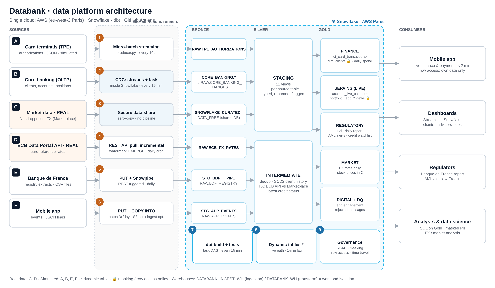

# Architecture and data flow



## How to read the diagram

- **Left, letters A to F:** the six places data comes from.
- **Middle, numbers 1 to 6:** how each source enters the platform (one ingestion method per source).
- **Snowflake box:** where the data is stored and transformed, in three layers (Bronze → Silver → Gold).
  Steps 7, 8 and 9 happen there.
- **Right:** who uses the result (the client app, analysts, compliance, the regulator).

It follows the three pillars from the course: **ingest** (A–F, steps 1–6), **transform** (steps 7–8),
**consume** (step 9 and the consumers).

**One cloud: AWS.** Snowflake runs on AWS in the Paris region (`eu-west-3`), so the data stays in France.
The loaders run on temporary GitHub Actions machines that send data to Snowflake over an encrypted
connection and keep nothing once the job ends; all data is stored in Snowflake on AWS.

## The sources (letters)

| | Source | Who produces it in real life | Real or simulated |
|---|---|---|---|
| A | Card payment terminals | the merchants' card network | simulated |
| B | Core banking system: clients, accounts, investment positions | Databank's own IT | simulated |
| C | Stock prices and exchange rates (Snowflake Marketplace) | Snowflake, as data provider | **real** |
| D | Euro exchange rates (ECB Data Portal API) | European Central Bank | **real** |
| E | Credit-incident registry files | Banque de France | simulated |
| F | Mobile app events (logins, screens, budgets) | Databank's app | simulated |

## The steps (numbers)

| # | Step | How | Result |
|---|---|---|---|
| 1 | Card payments arrive in small batches every 10 seconds | Python producer run by GitHub Actions | `RAW.TPE_AUTHORIZATIONS` |
| 2 | Changes in the core banking tables are captured | Snowflake streams + a capture procedure (CDC) | `RAW.CORE_BANKING_CHANGES` |
| 3 | Market data is shared, not copied | Snowflake Marketplace (secure data sharing) | database `SNOWFLAKE_CURATED_DATA_FREE` |
| 4 | New exchange rates are pulled once a day | GitHub Actions + Python: only days not yet loaded, then MERGE | `RAW.ECB_FX_RATES` |
| 5 | The regulator's daily file is loaded | file placed on a stage, then Snowpipe loads it | `RAW.BDF_REGISTRY` |
| 6 | App event files are loaded in batches | file placed on a stage, then `COPY INTO` | `RAW.APP_EVENTS` |
| 7 | Bronze → Silver → Gold, with tests | dbt, run by the task graph every 15 minutes | schemas `STAGING`, `INTERMEDIATE`, `MARTS` |
| 8 | The live path stays at most 1 minute behind | two dynamic tables | `MARTS.FCT_CARD_TRANSACTIONS`, `MARTS.ACCOUNT_LIVE_BALANCE` |
| 9 | Data is protected and served | roles, masking, row access policy, secure views | the app, analysts, compliance, the regulator |

## Orchestration

```
DBT.T_00_ROOT              every 15 min   capture core banking changes            (step 2)
 └── DBT.T_10_DBT_BUILD    after root     dbt build: run + test every model       (step 7)
      └── DBT.T_20_DBT_FRESHNESS          dbt source freshness: alert on late sources
```

GitHub Actions schedules (UTC): ECB rates on working days at 15:30, Banque de France file on working days
at 06:00, app events at 05:00, 11:00 and 17:00. The card stream is started by hand before a demo. The
dynamic tables refresh on their own. More in [orchestration_containers_iac.md](orchestration_containers_iac.md).

## Consumers

| Consumer | Snowflake role | Reads |
|---|---|---|
| Mobile app (the client) | `DATABANK_CLIENT_APP` | secure views `MARTS.APP_MY_*`, filtered to the logged-in client |
| Analysts and dashboards | `DATABANK_ANALYST` | `MARTS`, personal data masked |
| Compliance and AML | `DATABANK_COMPLIANCE` | `MARTS` with personal data visible, `AML_ALERTS`, `CREDIT_RISK_WATCHLIST` |
| Banque de France | export of `REG_BDF_DAILY_REPORT` | aggregated daily figures |
| Data team | `DATABANK_ENGINEER` | every layer, read-only outside dbt |

## Main design choices

- **ELT, not ETL:** raw data is stored untouched (JSON kept as text or `VARIANT`), so it can always be
  replayed. Cleaning happens in dbt, versioned in Git.
- **Bad data is quarantined, not dropped:** broken card messages go to `MARTS.DQ_REJECTED_AUTHORIZATIONS`
  with the reason.
- **Two independent sources for exchange rates** (C and D) are compared every day; a test warns if they
  differ by more than 0.5 %.
- **Workload isolation:** `DATABANK_INGEST_WH` for loaders, `DATABANK_WH` for dbt and dashboards, both
  XSMALL with 60-second auto-suspend, capped by the resource monitor `DATABANK_RM`.

The reasoning behind each choice (latency, scaling, cost, security…): [design_questions.md](design_questions.md).
