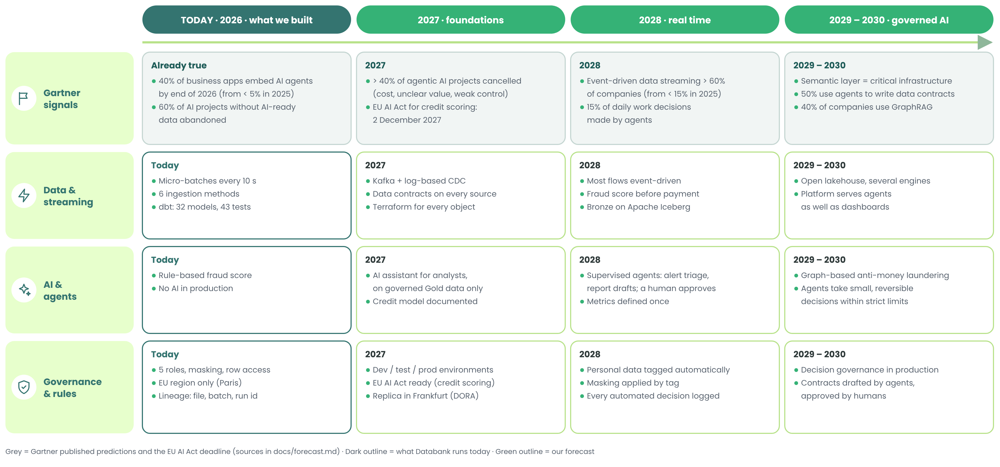

# Forecast 2027–2030: where the platform is heading

**Question:** based on Gartner's research and the tools emerging today, how is a bank's data platform
likely to evolve over the next few years, and what does that mean for Databank?

**How to read this page:** each section starts with what Gartner (or the regulator) says, with a source,
then what we expect for Databank. Gartner figures are quoted as published; the Databank timeline and the
scenarios are **our own forecast**, built on those signals.

*Top row (grey): what Gartner publishes. Dark outline: what Databank runs today. Green outlines: our forecast, year by year.*

## 1. The eight forces that will shape the platform

### 1.1 No AI-ready data, no AI

- **Gartner:** "through 2026, organizations will abandon 60% of AI projects unsupported by AI-ready data";
  63% of organizations lack the right data management practices for AI, or are not sure they have them [1].
- **For Databank:** the AI plans in our [target architecture](target_architecture.md) (fraud models, AI
  assistant) only work if the data underneath is tested, documented and fresh. This is why the first phases
  of our roadmap are about quality and governance, not AI. Our 43 dbt tests, freshness checks and quarantine
  table are the start of "AI-ready data".

### 1.2 From batch to event streaming

- **Gartner (top D&A trends 2026):** "agentic data streaming", the move from batch pipelines to
  event-driven flows that AI agents can act on, is expected to exceed **60% adoption by 2028, up from under
  15% in 2025** [2].
- **For Databank:** this confirms the hot path in our target design (Kafka + Flink). Today we already run a
  micro-batch stream for card payments; by 2028 we expect payments, core banking changes and app events to
  all flow as events, with batch kept only for files (Banque de France) and monthly reporting.

### 1.3 AI agents everywhere, but many projects will fail

- **Gartner:**
  - 40% of enterprise applications will include task-specific AI agents by the end of 2026, up from less than 5% in 2025 [3];
  - by 2028, 33% of enterprise software will include agentic AI, and at least 15% of day-to-day work decisions will be made autonomously [4];
  - **but** more than 40% of agentic AI projects will be cancelled by the end of 2027, because of rising costs, unclear business value and weak risk controls;
  - only about 130 of the thousands of vendors claiming "agentic AI" are genuine ("agent washing") [4].
- **For Databank:** agents will arrive first **inside the tools we already use** (Snowflake's assistant
  for analysts, dbt and SQL code assistants), not as a separate big project. We would start with low-risk,
  internal uses: analysts asking questions in plain language, explaining an AML alert, drafting a
  regulatory report for a human to check. No agent would approve a payment or a loan on its own before the
  governance in § 1.4 exists.

### 1.4 Governing decisions, not only data

- **Gartner:** "reducing AI agent risk with decision governance" is a 2026 top trend: decisions that are
  explicitly modelled are expected to be **5× more trusted and 80% faster** than ungoverned ones by 2029 [2].
  By 2030, 50% of AI agent deployment failures will come from weak **runtime** enforcement by AI governance
  platforms [5].
- **For Databank:** a bank must be able to explain every automated decision (to the client, to the
  Banque de France, to auditors). We would log each automated decision (input data, model version, score,
  outcome) as a Gold table, with the same masking and access rules as client data. This extends the
  lineage we already keep (source file, batch id, run id).

### 1.5 Data contracts written and enforced automatically

- **Gartner:** by 2030, 50% of organizations will use AI agents to turn governance policies and technical
  standards into **machine-verifiable data contracts** [5].
- **For Databank:** today our "contracts" are dbt tests and source freshness rules written by hand. The
  next step is explicit contracts per source (schema, freshness, owner) checked at ingestion; later, an
  agent drafts them from policies and a human approves them.

### 1.6 The semantic layer becomes critical infrastructure

- **Gartner:** by 2030, universal semantic layers will be treated as critical infrastructure, on a par
  with data platforms and cybersecurity, to improve AI accuracy, control costs and keep multi-agent systems
  consistent [5].
- **For Databank:** this is the "single source of truth" question from class, applied to AI. "Available
  balance", "active client" or "suspicious transaction" must mean the same thing in the dashboard, in the
  app and in an AI assistant's answer. We would define these metrics once (dbt Semantic Layer or Snowflake
  semantic views) on top of our Gold models.

### 1.7 Open table formats and the lakehouse

- **Gartner (Hype Cycle for Data Management 2025):** open table formats such as Apache Iceberg are rated
  **"transformational"**; the lakehouse is gaining momentum because it serves both warehouse modernisation
  and new AI workloads in one architecture [6].
- **Market signal:** at Snowflake Summit 2026, Iceberg v3 support and Snowflake-managed Iceberg storage
  (on AWS) were announced as generally available [7].
- **For Databank:** this supports moving Bronze to Iceberg on S3 (phase 4 of our roadmap): raw data in an
  open format, readable by Snowflake and by any other engine, which reduces lock-in.

### 1.8 Sovereignty and regulation

- **Gartner:** "sovereign AI acceleration" is a 2026 top trend: organisations keep data and AI under local
  jurisdiction because of geopolitical pressure [2].
- **Regulation:**
  - the EU AI Act classifies **credit assessment** as high-risk AI. The Digital Omnibus on AI (Regulation (EU) 2026/1744, in force since 27 July 2026) moved these obligations from 2 August 2026 to **2 December 2027** [8];
  - DORA (digital operational resilience for financial firms) has applied since January 2025.
- **For Databank:** keep everything in the EU (Paris, with Frankfurt as the recovery region), prefer
  AI models that run inside our Snowflake account so client data never leaves it, and have the credit-risk
  model documented, monitored and explainable **before December 2027**.

### Also on the radar: GraphRAG

Gartner expects 40% of enterprises to have used GraphRAG (knowledge graphs + large language models) by
2029 [2]. For a bank, the natural use is anti-money laundering: a graph of accounts, devices and payments
that an assistant can explore to explain *why* an alert was raised.

## 2. Databank forecast timeline

| Period | What we expect to change | Driven by |
|---|---|---|
| **2027** | Terraform and separate dev / test / prod; data contracts on every source; Kafka + log-based CDC for payments and core banking; AI assistant for analysts on Gold data only; credit-risk model ready for EU AI Act obligations (December) | AI-ready data (1.1), regulation (1.8), streaming (1.2) |
| **2028** | Most flows event-driven; Flink fraud scoring before payment; Bronze on Iceberg; metrics defined once in a semantic layer; first agents in operations (alert triage, report drafting) with a human approving | streaming (1.2), agents (1.3), lakehouse (1.7), semantic layer (1.6) |
| **2029–2030** | Decision governance in production: every automated decision logged and explainable; data contracts drafted by agents and approved by humans; graph-based AML; the platform serves AI agents as much as dashboards | decision governance (1.4), contracts (1.5), GraphRAG |

### The same payment, year by year

The example from the oral defense: Camille pays €12.40 for lunch at a bakery in Lyon.

| Year | What happens to her payment | What changed |
|---|---|---|
| Today (2026) | arrives in a 10-second batch; a rule checks fraud after it is accepted; she sees it in under 2 minutes | what we built |
| 2027 | arrives as an event; a data contract checks the message format the moment it enters the bank | streaming foundations, data contracts |
| 2028 | scored for fraud before it is accepted; if suspicious, an AI agent prepares the alert and a person decides | real-time scoring, supervised agents |
| 2029–2030 | if her card is used in Marseille 10 minutes later, an agent may freeze it for a few minutes (small, reversible) and a person reviews it | decision governance in production |

## 3. Three scenarios for 2030 (our judgment)

| | Cautious | **Expected** | Aggressive |
|---|---|---|---|
| Streaming | payments only | payments, core banking, app events | everything, batch kept only for files |
| AI agents | analysts' assistant only | assistant + supervised operational agents | agents take routine decisions (small payments, card blocks) within strict limits |
| Architecture | today's warehouse + Iceberg Bronze | lakehouse with Iceberg Bronze, Snowflake for Silver/Gold, semantic layer | fully open lakehouse, several engines on the same Iceberg tables |
| Main risk | falling behind competitors' app experience | integration effort and skills | cost overruns and regulatory exposure (Gartner's 40% cancelled agentic projects) |

We expect the **middle scenario**: Gartner's adoption figures point to streaming and agents becoming
mainstream, but its cancellation and governance warnings, plus banking regulation, argue against handing
financial decisions to agents early.

## 4. Emerging tools watchlist

Classified like a technology radar: **Adopt** (use now), **Trial** (pilot on one use case),
**Assess** (follow closely), **Hold** (wait).

| Tool or practice | Status in the market (Nov 2026) | Our call | Why |
|---|---|---|---|
| dbt (tests, docs, lineage) | mature | **Adopt** (already used) | foundation of AI-ready data |
| Snowflake dynamic tables | generally available | **Adopt** (already used) | simplest live path inside Snowflake |
| Apache Iceberg (v3) + managed Iceberg storage | GA on AWS [7] | **Trial** | open Bronze layer, less lock-in |
| Snowflake Postgres (operational database) | GA [7] | **Trial** | instant reads for the app without a second vendor |
| Kafka (Amazon MSK) + Flink | mature | **Trial** | event streaming for payments and fraud |
| Snowflake Openflow (managed connectors) | available | **Trial** | replaces our own loader scripts |
| Data contracts | emerging practice | **Trial** | Gartner's 2030 direction [5] |
| Semantic layer (dbt Semantic Layer, Snowflake semantic views) | maturing | **Assess → Trial in 2027** | one definition per metric for humans and AI [5] |
| Analyst AI assistant (Snowflake Cortex agents) | evolving fast | **Assess** | useful, but only on governed Gold data |
| GraphRAG for AML | early | **Assess** | strong fit for money-laundering networks [2] |
| Autonomous agents taking financial decisions | early, heavy "agent washing" [4] | **Hold** | regulation (EU AI Act) and Gartner's failure rates |

## 5. What this means for the project today

The forecast mostly **confirms the choices already made**:

- **ELT + medallion + dbt tests** = the "AI-ready data" Gartner says most AI projects lack.
- **A live path that is streaming-ready** (micro-batches today, Kafka tomorrow), in line with the shift to event-driven data.
- **One EU region, governance built in** (masking, row access, lineage) = sovereignty and AI Act readiness.
- **Snowflake + open formats as the next step** (Iceberg), so the platform can follow the lakehouse trend without being rebuilt.

## Sources

1. Gartner, *Lack of AI-Ready Data Puts AI Projects at Risk*, press release, 26 Feb 2025. <https://www.gartner.com/en/newsroom/press-releases/2025-02-26-lack-of-ai-ready-data-puts-ai-projects-at-risk>
2. Gartner Top Trends in Data and Analytics for 2026 (announced 16 June 2026), as reported by Let's Data Science. <https://letsdatascience.com/news/gartner-identifies-top-data-and-analytics-trends-a1d2914a>
3. Gartner, *Gartner Predicts 40% of Enterprise Apps Will Feature Task-Specific AI Agents by 2026*, press release, 26 Aug 2025. <https://gartner.com/en/newsroom/press-releases/2025-08-26-gartner-predicts-40-percent-of-enterprise-apps-will-feature-task-specific-ai-agents-by-2026-up-from-less-than-5-percent-in-2025>
4. Gartner, *Over 40% of Agentic AI Projects Will Be Canceled by End of 2027*, 25 June 2025, as reported by W.Media. <https://w.media/over-40-percent-of-agentic-ai-projects-could-face-the-axe-by-end-of-2027-gartner/>
5. Gartner, *Gartner Announces Top Predictions for Data and Analytics in 2026*, press release, 11 Mar 2026. <https://www.gartner.com/en/newsroom/press-releases/2026-03-11-gartner-announces-top-predictions-for-data-and-analytics-in-2026>
6. Gartner *Hype Cycle for Data Management, 2025* (Rosenbaum, Thanaraj), as summarised by Starburst. <https://www.starburst.io/info/gartner-hype-cycle-for-data-management-report-2025/>
7. SELECT, *Snowflake Summit 2026: what actually shipped*. <https://select.dev/posts/snowflake-summit-2026-what-actually-shipped-and-what-it-means>
8. Mondaq, *EU Digital Omnibus on AI enters into force*; Gibson Dunn, *EU AI Act Omnibus Agreement*. <https://www.mondaq.com/eu-digital-omnibus-on-ai-enters-into-force/1825722>, <https://www.gibsondunn.com/eu-ai-act-omnibus-agreement-postponed-high-risk-deadlines-and-other-key-changes/>
