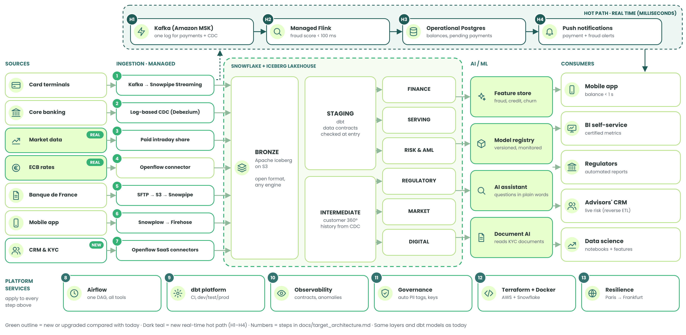

# Target architecture: the best case

**Question:** if Databank had an unlimited budget and access to the best platforms available today, how
would we design the pipeline, and what would change compared with what we built?

**Short answer:** the foundations stay the same (one cloud, Snowflake, medallion layers, dbt). What changes
is around them:
- a real-time **hot path** (Kafka + Flink) for payments and fraud, answering in milliseconds instead of a minute;
- an **open lakehouse** (Apache Iceberg files on S3) for raw data;
- **managed connectors** instead of our own scripts;
- **machine learning** for fraud, credit risk and churn;
- production-grade operations: Airflow, Terraform, data observability, a second region for disaster recovery.

*Green outlines are new or upgraded compared with [today's pipeline](architecture.md); the dark-teal band at the top is the
new real-time path (H1–H4). Numbers match the steps below.*

## 1. What stays the same, and why

| Kept | Why it is still the right choice with unlimited budget |
|---|---|
| **One cloud: AWS, Paris region** | data stays in France (GDPR, banking supervisors); a second cloud would add cost and risk without a business need |
| **Snowflake** as the analytics platform | governance, data sharing and workload isolation are already best in class; we move to the **Business Critical** edition for banking-grade security |
| **Medallion layers** (Bronze → Silver → Gold) | they keep raw data replayable and business tables stable |
| **dbt** for transformations | the same models and tests carry over; only the way dbt is run and checked improves |
| **Sources A to F** | the business does not change; a new source **G** (CRM, identity checks, open banking) is added |

This matters for the defense: today's pipeline was designed so that it can **grow into** the target without
being rebuilt.

## 2. Today vs best case, side by side

| Dimension | Today (what we built) | Best case (target) |
|---|---|---|
| **Payments (A)** | Python producer, micro-batches every 10 s | Kafka (Amazon MSK) event log, Snowpipe Streaming into Bronze |
| **Core banking (B)** | Snowflake streams on a replica, every 15 min | log-based CDC with Debezium on MSK Connect: every change in under a second |
| **Market data (C)** | free Marketplace data, 3-month delay | paid intraday feed shared through the Marketplace (e.g. LSEG, FactSet) |
| **ECB rates (D)** | our own Python script in GitHub Actions | Snowflake Openflow managed connector |
| **Banque de France (E)** | file uploaded to an internal stage, Snowpipe triggered by our script | secure SFTP (AWS Transfer Family) → S3 → Snowpipe auto-ingest on file arrival |
| **App events (F)** | gzip JSON file, `COPY INTO` 3 times a day | Snowplow tracker → Kinesis Firehose → Iceberg (Parquet) tables on S3, continuously |
| **New source (G)** | none | CRM, identity checks (KYC), open-banking APIs (PSD2) through managed connectors |
| **Raw storage** | Snowflake tables | **Apache Iceberg** tables on S3 (open Parquet format, readable by any engine), catalogued in Snowflake |
| **Freshness: payment in the app** | about 1 minute | **under 1 second** (hot path) |
| **Fraud detection** | rule-based score computed after the payment | ML model scoring **before** the payment is accepted (< 100 ms, Apache Flink) |
| **Serving to the app** | secure views in Snowflake | operational database (Snowflake Postgres) for instant reads; Snowflake for analytics |
| **Transformation** | dbt Project inside Snowflake | dbt platform (Fusion engine): automatic checks on every change, separate dev / test / prod |
| **Orchestration** | Snowflake task graph + GitHub schedules | Apache Airflow (Amazon MWAA): one DAG across Kafka, Snowflake, dbt, ML and reverse ETL |
| **Data quality** | 43 dbt tests + freshness checks | + data contracts at ingestion + anomaly detection (Monte Carlo) + end-to-end lineage (OpenLineage) |
| **Governance** | 5 roles, 4 masking policies, 1 row access policy | Horizon catalog with automatic detection of personal data, masking applied by tag, private network links (PrivateLink), bank-managed encryption keys |
| **Machine learning / AI** | none | feature store, model registry (fraud, credit risk, churn), AI assistant for analysts, document AI for KYC files |
| **Consumers** | Streamlit dashboard, SQL | + BI tool with certified metrics (Sigma / Power BI), reverse ETL to the CRM, automated regulatory reporting, push notifications |
| **Infrastructure as Code** | re-runnable SQL scripts + Terraform for the newest objects (BI warehouse, reviewer role, evidence schema) | Terraform for AWS and Snowflake, with plan, state and drift detection |
| **Containers** | one Docker job (ECB loader), built and run in GitHub Actions | Docker image per connector or job, stored in Amazon ECR |
| **Disaster recovery** | none (trial account) | replication Paris → Frankfurt with tested failover (DORA requirement) |
| **Environments** | one account | separate dev, test and prod accounts |
| **Cost** | €0: about 11.5 of the 400 free trial credits | tens of thousands of euros per month (see § 6) |

## 3. One payment, today and in the best case

Camille pays €12.40 for lunch at a bakery in Lyon (the example used in the oral defense):

| Step | Today | Best case |
|---|---|---|
| The payment reaches the bank | in a micro-batch, within 10 seconds | as a Kafka event, immediately (H1) |
| Fraud check | a rule, after the payment is accepted | a score in under 100 ms, **before** it is accepted (H2) |
| Camille sees it | pending payment and new balance in under 2 minutes | balance in an operational database and a push notification in under 1 second (H3, H4) |
| Reports | dbt rebuilds Gold every 15 minutes | the same dbt models, on Iceberg Bronze, orchestrated by Airflow (8, 9) |
| Her card is used in Marseille 10 minutes later | flagged after the fact in the reports | blocked in real time by the fraud score |

## 4. The target, step by step

### Hot path (dark teal, H1 to H4): real time, in milliseconds

| Step | What happens | Why |
|---|---|---|
| H1 · Amazon MSK (Kafka) | every payment and every core banking change becomes an event in one log | one stream feeds both the real-time path and the warehouse: the data is written once |
| H2 · Managed Apache Flink | each payment is scored for fraud in less than 100 ms, **before** it is accepted | stopping fraud after the fact is too late; this is the only place where milliseconds matter |
| H3 · Snowflake Postgres | balances and pending payments are kept in an operational (OLTP) database | an app needs instant single-row reads; an analytics warehouse is built for large scans |
| H4 · Push notifications | "You paid 12.40 € at…" and fraud alerts reach the client in under a second | the experience modern banks offer |

### Ingestion (1 to 7): managed services on AWS

| Step | Source | Method |
|---|---|---|
| 1 | A · payments | Kafka producers → MSK → Snowpipe Streaming into Bronze |
| 2 | B · core banking | Debezium reads the database's transaction log (log-based CDC): no load on the core system, every change kept |
| 3 | C · market data | paid intraday feed, still shared with zero copy |
| 4 | D · ECB | Snowflake Openflow connector: no script to maintain |
| 5 | E · Banque de France | SFTP server managed by AWS → S3 → Snowpipe loads each file as soon as it arrives |
| 6 | F · app events | Snowplow collects events → Kinesis Firehose writes them as Iceberg (Parquet) tables on S3 |
| 7 | G · CRM, KYC, open banking | Openflow connectors for SaaS APIs, incremental |

### Storage and transformation

- **Bronze is an open lakehouse:** raw data is stored as Apache Iceberg tables (Parquet files on S3). Snowflake
  reads and writes them, but so could Spark or any other engine. This answers the course questions on
  file formats and lock-in (see [design_questions.md](design_questions.md#7-file-formats-csv-json-parquet)).
- **Silver:** the same staging models as today, plus **data contracts** (each source promises a schema;
  a breaking change is stopped at the door) and a **customer 360°** view combining core banking, CRM, KYC
  and app behaviour.
- **Gold:** the same business domains, plus a **Risk & AML** domain (features and a graph of linked
  accounts to detect money-laundering networks). Regulatory reports are generated automatically.
- **AI / ML:** a feature store shared by fraud, credit-risk and churn models; a model registry that
  versions and monitors them; an AI assistant (Snowflake Cortex) so analysts can ask questions in plain
  language; document AI to read identity documents during onboarding.

### Platform services (8 to 13): apply to every step

| Step | Service | What it adds |
|---|---|---|
| 8 | Orchestration: Airflow (Amazon MWAA) | one DAG across all tools, retries, deadlines (SLAs), alerts to the on-call owner |
| 9 | dbt platform (Fusion engine) | every code change is built and tested automatically before production; column-level lineage |
| 10 | Quality and observability | data contracts, automatic anomaly detection on volumes and values, lineage from source to dashboard |
| 11 | Governance and security | Horizon catalog, automatic personal-data tags, masking by tag, PrivateLink, bank-managed keys |
| 12 | DevOps | Terraform for AWS + Snowflake, Docker images in ECR, CI/CD, secrets in AWS Secrets Manager |
| 13 | Resilience (DORA) | replication to Frankfurt, tested failover; data loss limited to minutes, recovery in under an hour |

## 5. Freshness per use case: today vs target

| Use case | Today | Target |
|---|---|---|
| 1 · Payment visible in the app | ~1 minute | < 1 second |
| 1b · Fraud check | after the payment, rule-based | before the payment, ML model, < 100 ms |
| 2 · Portfolio value | daily, 3-month-old free prices | intraday, real prices |
| 3 · Personal dashboards | 15 minutes | a few seconds (dynamic tables on streamed data) |
| 4 · Regulatory reports | daily, prepared tables | daily, generated and submitted automatically, fully traced |

## 6. What it would cost (order of magnitude)

> Illustrative only: this is what a real bank would pay for the target design. Our project itself uses
> only free tiers and free trial credits and costs €0.

These are rough monthly ranges for a mid-sized retail bank (a few million clients), not quotes. The point
is the **order of magnitude** and **where the money goes**.

| Item | Rough range per month |
|---|---|
| Snowflake (Business Critical, several warehouses, replication) | €20k – €60k |
| Kafka (MSK) + Flink + Kinesis | €5k – €15k |
| Airflow (MWAA), Openflow, S3 storage | €2k – €5k |
| dbt platform, data observability, BI licences, reverse ETL | €5k – €20k |
| Paid market data feed | €5k – €30k |
| **Total** | **roughly €40k – €130k per month** |

The biggest lever is the same as today: **compute**. Streaming everything all day is what makes the target
expensive, which is why even with an unlimited budget we would keep batch for everything that does not
need to be live.

## 7. How we would get there from today

Because the foundations are the same, the migration can be done in steps, each one useful on its own:

| Phase | Change | Why first |
|---|---|---|
| 1 | Terraform for the existing Snowflake objects; dev / test / prod accounts; dbt checks on every change | safety before speed |
| 2 | Kafka + Debezium for sources A and B; Snowpipe Streaming | biggest freshness gain for the main use case |
| 3 | Flink fraud scoring and the operational store for the app | the hot path depends on phase 2 |
| 4 | Iceberg Bronze on S3; managed connectors for D, E, F, G | open formats and less code to maintain |
| 5 | Feature store, ML models, AI assistant; replication to Frankfurt | value on top of trusted, fresh data |

## 8. What we would still **not** do

| Not done | Why |
|---|---|
| Multi-cloud | no business need; more cost, more security surface, harder compliance |
| Kubernetes run by the team | managed services (MSK, Flink, MWAA, Snowflake containers) already scale; running clusters ourselves adds work, not value |
| Data mesh | it fits large organisations with many independent data teams; Databank would first need several domain teams |
| Streaming everything | regulatory reports and monthly analytics do not need it: the cost would grow with no benefit |
